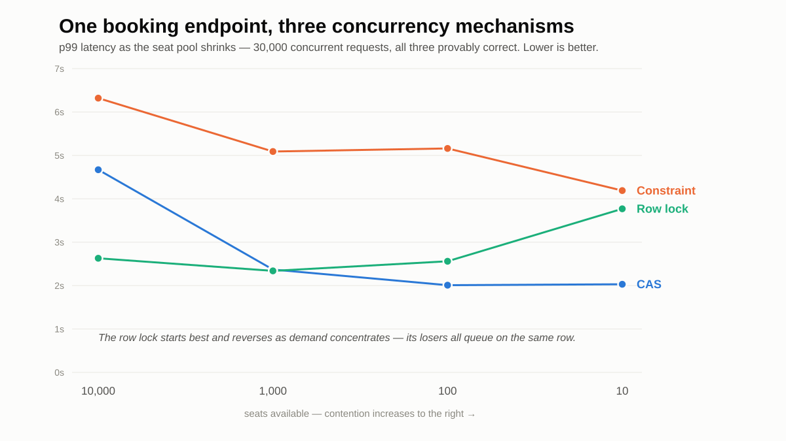
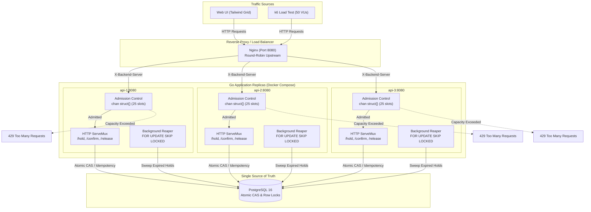

# Holdfast

A booking engine built to prove one property under load: **concurrent requests can never
double-sell the same seat, and never lie about the outcome** — no overselling, no false
"sold out", and a retried request always resolves to exactly one booking.

The interesting part isn't that it books seats. It's that every correctness claim is backed
by a concurrent test that would fail if the claim were false — not asserted, measured.

---

## The headline finding: there is no single best concurrency mechanism

I implemented three ways to make a seat booking safe under contention, behind one interface,
and benchmarked them against 30,000 concurrent requests as the seat pool shrank from 10,000
seats down to 10 (contention rising left to right):

| Seats  | CAS  | Unique constraint | Row lock |
| ------ | ---- | ----------------- | -------- |
| 10,000 | 4.67 | 6.32              | **2.63** |
| 1,000  | 2.37 | 5.09              | **2.34** |
| 100    | **2.01** | 5.16          | 2.56     |
| 10     | **2.03** | 4.19          | 3.77     |

*p99 latency in seconds, batch 3. Lower is better; the winner in each row is bold.*



**The row lock wins when demand is spread out; compare-and-swap wins when it concentrates on
a few hot seats; the unique constraint never wins.** That crossover reproduced across
independent runs. The reason is what a *losing* request pays in each mechanism: the row lock's
losers queue behind the same row (cost grows as contention rises), the constraint's losers each
fire a full INSERT that gets rejected (a wasted write every time), and CAS's losers bail out on
a single cheap read.

The full write-up — including a hypothesis my own numbers **disproved** (that the constraint
slows down because more inserts fail — it doesn't; failures rise while its latency falls), and
an honest "what this does not measure" section — is in **[docs/M1-results.md](docs/M1-results.md)**.

---

## Exactly-once under retries

If a booking commits but the response is lost and the client retries with the same request id,
the customer must end up with **exactly one** booking — never two, never zero-but-charged.

This is proven with a test that fires **1,000 concurrent duplicate pairs** at the same seat and
asserts every pair lands on a legal outcome — and that verifies the two goroutines' execution
windows actually *overlapped in time*, so the test proves a real race rather than passing
because the requests happened to serialize.

Design and reasoning: **[docs/M2-design.md](docs/M2-design.md)**.

---

## System Architecture



---

## How it's built

- **Go** for the booking engine, **PostgreSQL** for storage, **pgx** driver.
- Each mechanism lives behind one `bookFunc` interface so the benchmark harness is identical
  across all three — the only variable is the mechanism.
- Correctness harness (`internal/booking/booking_test.go`): many goroutines released by a single
  starting gun, `-race` clean, asserting exactly-N-booked, zero duplicates (checked with
  `GROUP BY seat_id HAVING count(*) > 1`, because a totals-only count can hide a double-booked
  seat behind an unsold one), and DB-vs-response reconciliation.
- Idempotency via a claim-first pattern: the request id is inserted under a `UNIQUE` constraint
  at the *start* of the transaction, so a duplicate blocks until the original commits or rolls
  back, then reads back the original outcome.

## Flash-sale load test & admission control (M6)

Under an unmitigated flash sale, database connection exhaustion can cause latency cliffs and 500 errors. Holdfast introduces **zero-allocation admission control** via a buffered channel semaphore (`chan struct{}`) that bounds in-flight queries per replica and sheds peak bursts with `HTTP 429 Too Many Requests` + `Retry-After: 1`.

Benchmarked using `k6` with 50 concurrent virtual users continuously hammering 3 API replicas behind an Nginx load balancer for a 40-seat inventory:

| Metric | Measured Value |
| :--- | :--- |
| **Total Requests** | **8,423 requests** in 5.0s (**1,677 req/sec**) |
| **Seats Claimed** | **40 / 40** (Exactly 40 `201 Created`, **0 double-bookings**) |
| **Conflicts Handled** | **8,354** (`409 Conflict`) |
| **Load Shed (Admission Control)** | **29** (`429 Too Many Requests`) |
| **Internal Server Errors (5xx)** | **0 (0.00%)** |
| **Latency (p50 / p90 / p95)** | **27.26 ms** / **43.46 ms** / **49.37 ms** |

---

## Status

| Milestone | State |
| --------- | ----- |
| M0 — correctness contract | done ([docs/M0-contract.md](docs/M0-contract.md)) |
| M1 — 3-mechanism shootout, measured crossover | done ([docs/M1-results.md](docs/M1-results.md)) |
| M2 — exactly-once under retries | done, proven |
| M3 — REST API & live interactive web UI | done (Go 1.22 ServeMux + Tailwind dark mode) |
| M4 — expiring holds (hold → confirm state machine) | done (background reaper with `FOR UPDATE SKIP LOCKED`) |
| M5 — multi-instance correctness behind a load balancer | done (3 Docker replicas + Nginx round-robin) |
| M6 — flash-sale load test + admission control | done (1,677 req/s, p95 49ms, 0 errors) |

Full spec and milestone breakdown: **[PLAN.md](PLAN.md)**.

## Reference

**[docs/holdfast-reference.html](docs/holdfast-reference.html)** — the field manual. Open it in a
browser. Every mechanism with its code and what a losing request pays, the harness design including
the three times it measured the wrong thing, the measured crossover, the claim-first idempotency
pattern, the current state of the expiring-holds work, and a glossary.

## Running it

```sh
make db-up      # start Postgres in Docker (waits for the healthcheck)
make migrate    # apply every migration in sorted order
make test       # run the suite with -race
```

`make db-down` stops the container but keeps the data volume, so applied migrations survive.
`make db-reset` drops the volume too — use that for a genuinely clean slate.
