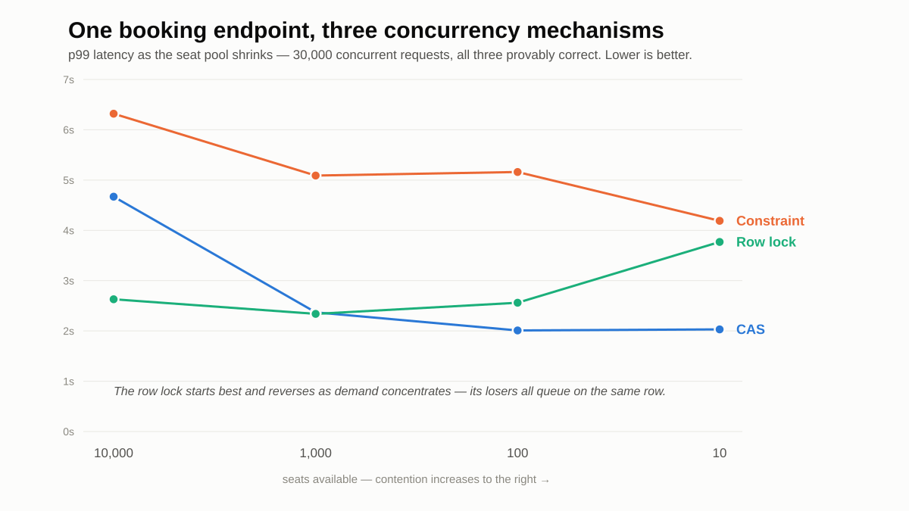
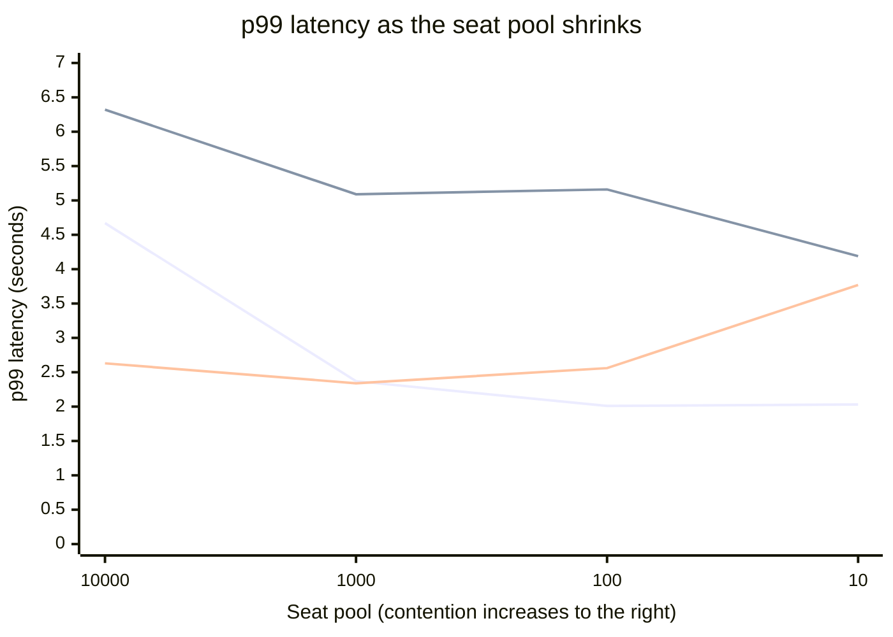
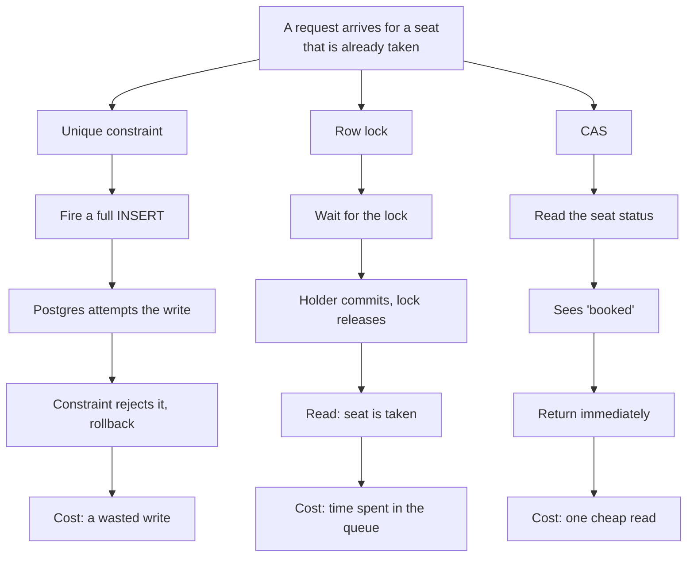

# M1 — The Mechanism Shootout: Results

## What was measured

For the past two weeks we have been constantly testing and benchmarking the different metrics in this fast-paced booking system. We throw 30k requests at all three methods: unique constraints, row locking, and CAS. We also changed `setupArena` so that more than one seat can be booked.

We fire the requests in batches of 10k and measure the total time each batch takes, to see the performance, the number of seats booked, and the number of `seat_taken` responses (the requests that lost the race). We also record the p99 value of each batch and derive throughput from it. The seat count is varied through an array — 10k, 1k, 100, and 10 seats available to book — against the same 30k incoming requests. We tightened the contention using an 80/20 split, where 80% of requests target 20% of the seats. We also leave a 6 second gap between each batch, so that a batch which has not finished does not overlap the next one and skew the results.

## The numbers

Postgres has a 90 connection pool open for the 30k requests, which splits to about 111 requests per connection. Those requests queue for their turn, and that queueing delay is included in the metrics — but since every mechanism faces the same pool, the comparison stays equal. The constraint comes out as the slowest at every level, from the 10k-seat run down to the 10-seat run — it is the highest number in all four rows. But it does not get worse as seats get scarce; it gets better, 6.32 down to 4.19. The row lock is the only mechanism that degrades as contention rises, 2.63 up to 3.77, and the cost that grows is the queue the row lock creates: with fewer seats, more requests pile up behind the same row. CAS moves the opposite way, 4.67 down to 2.03, because a losing request exits on a single read rather than queueing on a lock or spending a rejected write. Note that "slowest at every level" and "the one that degrades" are two different claims here, and they land on two different mechanisms.

We first wrote that the constraint slows down because more inserts fail as seats get scarce. Our own numbers contradict that. With 30k requests against 10k seats about 20,000 inserts fail; against 10 seats about 29,990 fail. Failures go UP as seats shrink while the constraint's latency goes DOWN, so failed writes cannot be what is driving it. What moves the same direction as the latency is the number of COMMITTED inserts: 10,000 at 10k seats against 10 at 10 seats. A committed insert leaves a row, an entry in the unique index, and a WAL record that has to be flushed before commit returns; a rejected one is turned away at the index and leaves none of the three. **We have not profiled this, so treat it as the likely explanation rather than a measured one.** What IS established is the negative: the failed-write story is ruled out by our own data. We also saw that the max time of a request (the worst case in the run) and the p99 are not far apart, so the requests were fairly evenly timed.

p99 latency in seconds, batch 3:

| Seats  | CAS  | Constraint | Row lock |
| ------ | ---- | ---------- | -------- |
| 10,000 | 4.67 | 6.32       | 2.63     |
| 1,000  | 2.37 | 5.09       | 2.34     |
| 100    | 2.01 | 5.16       | 2.56     |
| 10     | 2.03 | 4.19       | 3.77     |

Lines in order: CAS, constraint, row lock. The row lock starts lowest and crosses upward as
the seat pool shrinks — that crossing is the main finding.

## Which mechanism wins, and why

What a _losing_ request actually does in each mechanism:

CAS wins clearly every time so far, but we also learned that for bigger ticket sizes row locking can work great too. The constraint is simply bad for this case. The constraint also gets worse and worse as seats decrease, because inserts get rejected more often at smaller seat counts, where more people are fighting over the same seats.

## The M0 bet: confirmed or overturned

For the M0 bet: no, row locking did not work out best. It has its use case, but CAS came out very well. CAS came out best across the test cases we made. For row locking the situation got bad as the number of seats available to book was reduced, which increased the row lock queue latency.

## What this does not measure

Even after the whole lab we ran, we cannot fully say these numbers and findings are exactly the performance of the contention. Other factors — database and system latency, database pool latency, and queue timings — are included as well. So this is a good end-to-end request performance test, but not an isolated contention test.

The test is also done on a local machine, with the database in a local Docker container. Going over a network adds dropped requests and added latency; even in milliseconds, it still lowers the performance metrics compared to running locally.

The seat split was fixed at 80/20. Even when the number of tickets varies, the split stays the same. Perhaps at 50/50 row locking would take the lead over CAS — we never proved that.

---

## Tweet thread

_Attach `img/m1-crossover.png` to tweet 1._

**1/3**
Built the same booking endpoint 3 ways — unique constraint, row lock, compare-and-swap.

30,000 concurrent requests. Seat pool shrunk from 10,000 down to 10.

All three provably correct. But there is no single winner.

**2/3**
Row lock wins when demand is spread. Concentrate it and it drops to second worst — every loser queues on the same row.

CAS wins as contention tightens. Its losers read once and leave.

The constraint never wins. Every loser fires a real INSERT that Postgres rolls back.

**3/3**
The hardest part wasn't the mechanisms.

It was learning not to trust my own benchmark. Three separate times it measured something other than what I thought — overlapping batches, serialised releases, a race that resolved in 5ms.

Every set of numbers looked reasonable.

### Single-tweet version

Built one booking endpoint 3 ways: unique constraint, row lock, CAS.

30,000 concurrent requests, seat pool shrunk 10,000 → 10.

No single winner. Row lock wins when demand spreads, CAS when it concentrates, the constraint never.

All correct. The cost of losing is what differs.

## LinkedIn post

_Attach `img/m1-crossover.png`._

I built the same booking endpoint three times, on purpose.

The problem: 30,000 people, a limited number of seats, and a hard rule that the system must never sell the same seat twice.

There are three standard ways to guarantee that in Postgres:

- A unique constraint — fire the INSERT and let the database reject duplicates
- A row lock — SELECT ... FOR UPDATE, so only one request holds a seat at a time
- Compare-and-swap — UPDATE ... WHERE status = 'free', and check how many rows changed

All three are correct. I proved that first: exactly the right number of seats sold, no duplicates, race detector clean.

So I benchmarked them instead. Same 30,000 requests, but I varied how concentrated the demand was — 10,000 seats, then 1,000, then 100, then 10.

The result surprised me.

There is no overall winner. The row lock was fastest when demand was spread across many seats. As seats got scarcer it fell to second worst, because every loser has to queue on the same row and wait for the holder to commit. CAS took the lead in the other direction — its losers read once, see the seat is gone, and leave without waiting for anything.

The unique constraint lost everywhere. Its losers do not get a cheap exit. Each one fires a real INSERT that Postgres has to attempt and then roll back.

The part that took longest was not writing the mechanisms. It was learning not to trust my own benchmark.

Three separate times the harness was measuring something other than what I thought:

1. Batches were overlapping, so contention from one run bled into the next.
2. Goroutines were being released one at a time instead of together, so nothing actually raced.
3. With a single seat, the contest resolved in five milliseconds — long before enough competitors arrived to contend at all.

Each one produced numbers that looked completely reasonable and meant nothing.

The lesson I did not expect to learn: knowing which mechanism is faster matters far less than knowing whether your measurement is telling you the truth.
